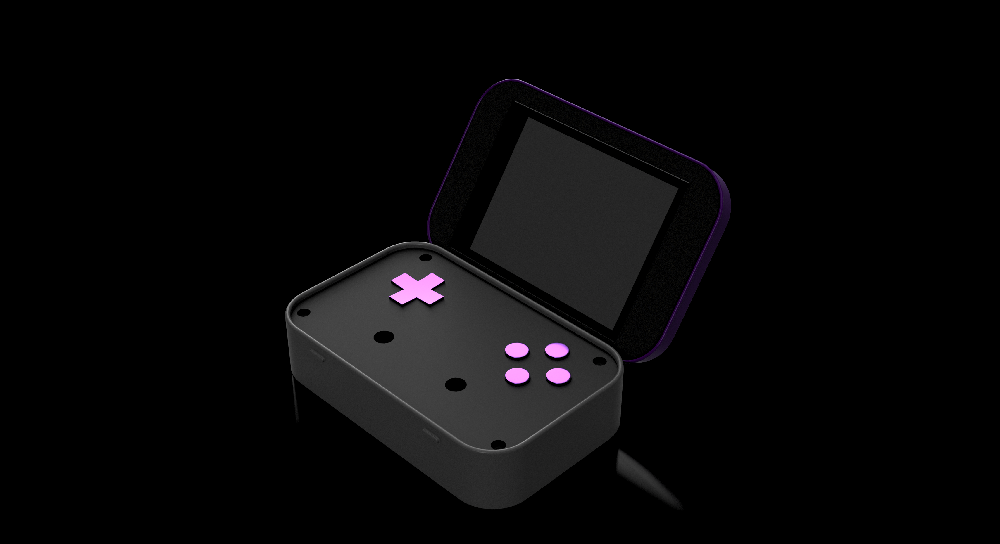
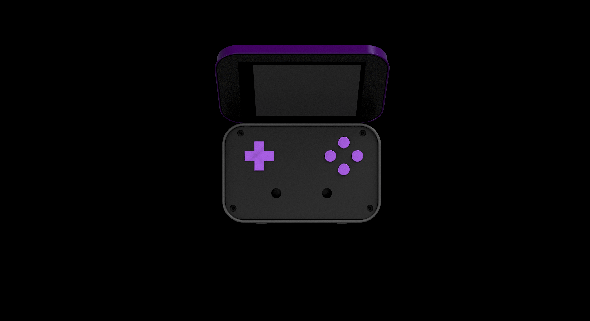
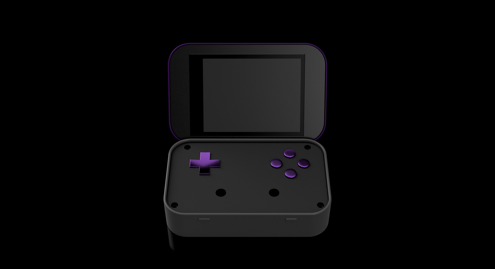

If you want to support this project you can [buy me a coffee!](https://buymeacoffee.com/nbthegr8)

> ## ⚠️ **THIS IS A WORK IN PROGRESS**
> **I am actively working on this project and these steps are not accurate or finished.**

# PiMINT

A handheld game console that fits in an Altoids tin, built from only off the shelf parts anyone could buy or already had lying around. It runs on a Raspberry Pi and uses RetroPie for retro gaming.

| | |
|---|---|
| **Role** | Solo: industrial design, CAD, electronics, firmware |
| **Timeline** | 2022 – now |
| **CAD** | Fusion 360 |
| **Tools** | 3D printer, soldering iron, Python |
| **Hardware** | Raspberry Pi, SPI displays, Teensy, LiPo systems |

---

## The Goal

Fit a working retro console into a pocket tin without custom PCBs or expensive parts. The tin's fixed internal volume was the hardest constraint on every other choice.

### Constraints

- About 95 × 60 × 21 mm outer envelope, steel and conductive
- Off-the-shelf boards only
- Battery, compute, display, and controls stacked with no wasted height

---

## Design

### Enclosure & CAD

I modeled the tin and every board first, then designed a printed internal frame to locate the stack and insulate it from the tin walls. All printed parts were made from PLA to keep cost low and make manufacturing simple.

*Rev 2, top view. Fusion 360 render.*

### Electronics & Interconnect

The display runs over SPI and the controls over the Pi's GPIO. An FPC ribbon cable routes through the hinge to connect the Pi to the display.

*Wiring diagram coming soon.*

### What Went Wrong

On the first iteration nothing fit, wires shorted against the tin, and I destroyed the Pi and had to buy a new one. Each failure became a rule for the next revision: insulate everything, model the wires and not just the boards, and test fit before soldering.

*Rev 2, front view. Fusion 360 render.*

### What I'd Change Next

Design a custom PCB to combine the controls and power board, and look at how the lid cutouts could be stamped in production instead of cut by hand.

---

## Parts List

- **Altoids Tin**  
  The enclosure. Every part has to fit inside it.

- **Raspberry Pi**  
  Main compute running emulation.

- **EyeSpi Display**  
  An Adafruit display with an attached FPC connector for SPI.  
  [Buy it here](https://www.adafruit.com/product/2090)

- **Adafruit Soft Tactile Buttons**  
  High-quality buttons for creating a tactile controller interface.  
  [Buy it here](https://www.adafruit.com/product/3101)

- **Teensy LC (or alternative microcontroller)**  
  A compact microcontroller for handling the game controller.  
  [Buy it here](https://www.pjrc.com/teensy/teensyLC.html)

- **LiPo Battery**  
  Single-cell LiPo that powers the console.

- **5V LiPo Charge Boost Board**  
  A power management board for recharging and boosting the voltage from a LiPo battery.  
  [Buy it here](https://www.adafruit.com/product/2465)

- **SD Card**  
  Any SD card above 8GB works, but 32GB or higher is recommended. Keep in mind that this is where all your games will be stored.  
  [Learn more](https://retropie.org.uk/docs/SD-Cards/)

---

## 3D Prints

All printed parts are PLA. The STL files are in this repo.

*Print settings coming soon.*

---

## Software

You'll need the following software to set up your game console:

1. **RetroPie**  
   A free, open-source platform for retro gaming on Raspberry Pi.  
   [Download it here](https://retropie.org.uk/)

2. **Raspberry Pi Imager**  
   An official tool for flashing OS images to SD cards.  
   [Download it here](https://www.raspberrypi.com/software/)

---

## Setup Guide

### Step 1: Install Raspberry Pi Imager

1. Download and install the [Raspberry Pi Imager](https://www.raspberrypi.com/software/) for your operating system.
2. Insert your SD card into your computer using an SD card reader.

### Step 2: Flash RetroPie onto the SD Card

1. Open the Raspberry Pi Imager.
2. Select **Choose OS** → **Game OS** → **RetroPie**.
3. Choose your SD card from the **Storage** menu.
4. Click **Flash** to write the image onto the SD card.

### Step 3: Insert the SD Card into Your Raspberry Pi

Once the flashing is complete, safely eject the SD card and insert it into your Raspberry Pi.

---

## Pick a Theme

You can use most EmulationStation themes with this system. Here are my favorites.

- **Art Book Next**  
  A clean, modern theme with cool covers.  
  [Get it here](https://retropie.org.uk/forum/topic/33010/theme-art-book-next)

- **Epic Noir**  
  A dark, stylish theme with great game art.  
  [Get it here](https://retropie.org.uk/forum/topic/25351/epic-noir-dark-mode-theme)

- **Obsidian**  
  A very minimal and clean theme.  
  [Get it here](https://retropie.org.uk/forum/topic/35460/theme-obsidian-simple-and-modern-emulationstation-theme-for-retropie)
